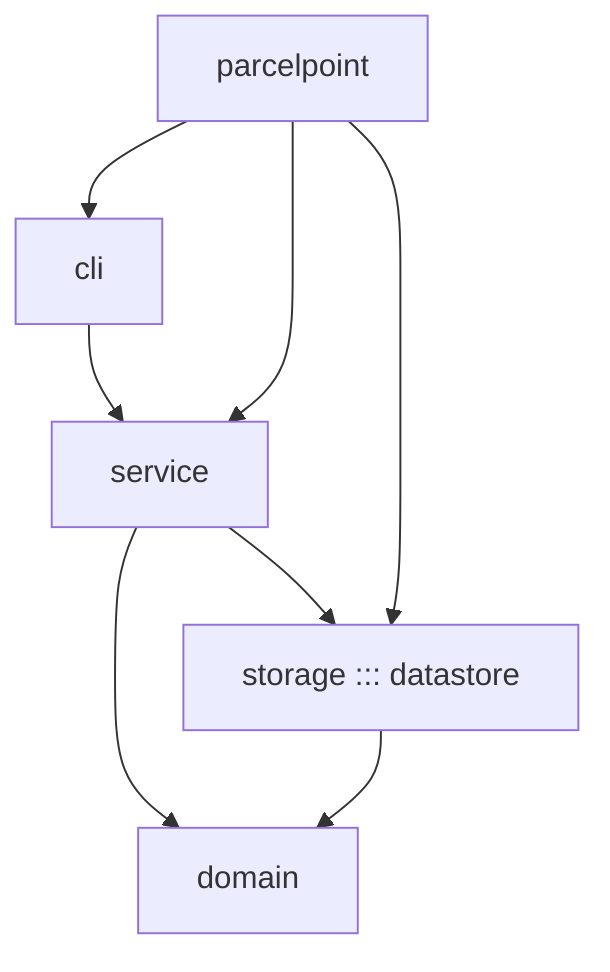
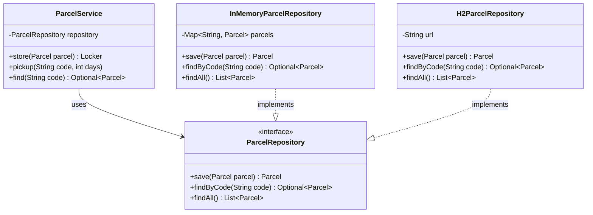
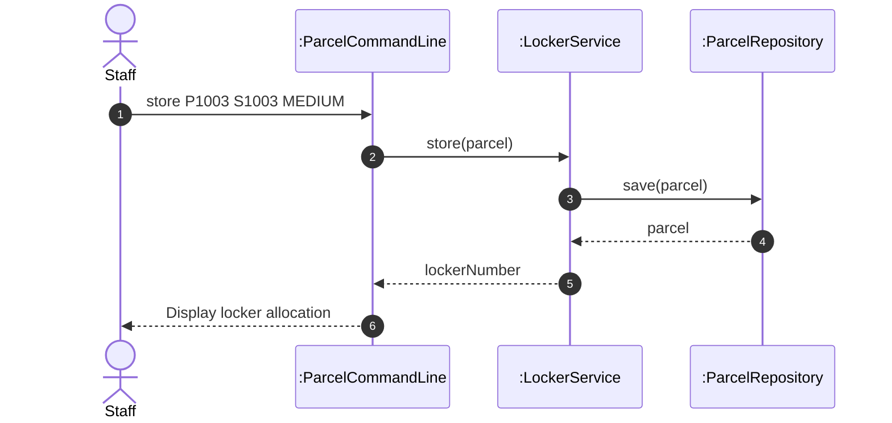

# Lab Report, Designing the Data Management Layer with H2

Repository URL: https://github.com/Earnpemi/itcs382-h2-lab.git

## Tools

| Item | Version or name |
| --- | --- |
| JDK | |
| Maven | |
| IDE | |
| AI tool and exact model, if you used one | |

## Part 0. From a store in memory to H2

Commit of the starter, before any change:

0.3 Your prediction for `staff`, written before the second run:

Output of the second run, for `staff` and `quit`:

```text
Free lockers: 3
```

State in one sentence where you think the parcels of the first run were kept.

0.5 The line of Main that you would change to keep the parcels somewhere else:

```java
ParcelRepository repository = new H2ParcelRepository();
```

0.6 Commit of the switch to H2:

0.7 Output of `SELECT * FROM PARCEL;` after you stored two parcels:

```text
    sql> SELECT * FROM PARCEL;
CODE  | STUDENT_ID | PARCEL_SIZE | STATUS | LOCKER_NUMBER
P1001 | S1001      | SMALL       | STORED | 1
P1002 | S1002      | LARGE       | STORED | 3
(2 rows, 29 ms)
```

0.8 Explain why ParcelPoint could not start while the H2 Shell was open, and identify the class that wrote the message `Cannot create the PARCEL table`.
Ans: Why it couldn't start: H2 operates in embedded mode by default, which opens an exclusive file lock on the ./data/parcelpoint database file. While the H2 Shell process held this lock open, the main application process was blocked from opening a concurrent connection to the same file.

Class that wrote the message: parcelpoint.storage.H2ParcelRepository

0.9 Explain why `staff` shows no parcel while `find` shows each one, and why all three lockers look free.
Ans: find issues an explicit SQL query (SELECT * FROM PARCEL WHERE CODE = ?) directly to the database for a specific item, successfully retrieving its record from disk.

staff relied on the findAll() repository method, which was returning an empty list (List.of()) prior to implementation. Because staff computes free lockers dynamically by iterating over the returned list of active parcels, returning an empty list caused staff to display zero parcels and report all 3 lockers as free.

0.11 Your findAll method:

```java
9f86fb1
```

Commit that adds findAll: 
Method:
@Override
public List<Parcel> findAll() {
    String sql = "SELECT * FROM PARCEL ORDER BY CODE";
    List<Parcel> parcels = new ArrayList<>();
    try (Connection connection = connect();
         PreparedStatement statement = connection.prepareStatement(sql);
         ResultSet row = statement.executeQuery()) {

        while (row.next()) {
            parcels.add(toParcel(row));
        }
        return parcels;
    } catch (SQLException e) {
        throw new IllegalStateException("Cannot read the parcels", e);
    }
}

0.12 Output of `SELECT * FROM PARCEL;` after the pickup:

```text
CODE  | STUDENT_ID | PARCEL_SIZE | STATUS    | LOCKER_NUMBER
P1001 | S1001      | SMALL       | PICKED_UP | null
P1002 | S1002      | LARGE       | STORED    | 3
(2 rows, 32 ms)
```

0.13 Optional. Describe what `find P9999'OR'1'='1` showed while the SQL was joined from strings, and what it showed after you put the placeholder back.
Ans: With String Concatenation: The injected input manipulated the SQL syntax into SELECT * FROM PARCEL WHERE CODE = 'P9999' OR '1'='1', which evaluated to TRUE for every row and bypassed the query logic to return the first matching parcel record regardless of its code.

With Prepared Statement Placeholders (?): The engine treated P9999'OR'1'='1 strictly as a literal string value for CODE, searching for an exact literal match and returning No parcel with code P9999'OR'1'='1.

## Part A. Model the design

A1 Complete the flowchart with one node for each package and one arrow for each dependency, from the package that uses to the package that is used. Mark the package that accesses the data store.



State whether cli depends on storage, and explain why.
Ans: No, cli does not directly depend on storage.

Reason: cli only interacts with the service layer to execute application use cases (such as storing or picking up parcels) and does not directly reference any repository classes or database implementations inside storage. The service layer acts as an intermediary that uses storage to persist data, keeping the user interface completely decoupled from data access logic.

A2 Complete the class diagram of the data management layer with ParcelService, the interface ParcelRepository with its three operations, and the two classes that implement it.



A3 Draw a sequence diagram for the command `store P1003 S1003 MEDIUM`, from the staff member to the repository. Show each message as an operation of the class that receives it.



Explain why the last lifeline is the interface ParcelRepository rather than H2ParcelRepository.
Ans: The last lifeline uses the interface ParcelRepository because of the Dependency Inversion Principle (and the Repository Pattern). The high-level business logic (LockerService) only depends on the abstract ParcelRepository interface rather than a concrete implementation class like H2ParcelRepository. This decouples the service layer from the underlying persistence mechanism, allowing storage implementations to be swapped out without altering the service logic.

## Part B. Design questions

1. Identify the files that you changed to move from the store in memory to H2, and explain why no other class had to change. Use the terms of this course.
Ans: Files changed: Main.java and H2ParcelRepository.java.   
Why: The project uses Loose Coupling and the Repository Pattern. The service layer depends on the ParcelRepository interface, so changing the database class does not break other code.

2. The PARCEL table stores the size of a parcel as SMALL, MEDIUM or LARGE rather than as 1, 2 or 3. Identify the type of connascence between ParcelSize and the table in each case, and explain which one is weaker.
Ans: SMALL, MEDIUM, LARGE: Connascence of Meaning (sharing string labels).
1, 2, 3: Connascence of Value (sharing numeric codes).

Weaker: Using string labels (SMALL, MEDIUM, LARGE) is weaker because it is self-explanatory and avoids bugs from wrong number mappings.

3. Project Phase 2 asks for a data store that needs no separate server. Explain why an embedded database such as H2 meets this rule, and describe the limit of an embedded database that Step 0.8 showed.
Ans: Why H2 fits: H2 is an embedded database that runs inside Java and saves data directly to local files, so it needs no separate database server.

Limit in Step 0.8: Only one process can open the file at a time. The app cannot connect while the H2 Shell is using the file

4. State the data store that you would choose for your Project Phase 2 team, files or an embedded database, the requirement that drives the choice, and the package that will access it.
Ans: Choice: Embedded Database (H2).

Requirement: Needs fast SQL queries and safe data storage without installing a separate server.

Package that accesses it: storage package.


## AI usage declaration

| AI tool and exact model | Date | Purpose | Files or answers it produced or changed | How you checked its output |
| Gemini 2.5 Flash | 2026-11-09 | Environment troubleshooting, code implementation guidance, and lab report answers | H2ParcelRepository.java (findAll method), LAB_REPORT.md (Part 0, Part A diagrams, Part B design questions) | Compiled code with Maven, tested commands in ParcelPoint CLI, verified database queries in H2 Shell, and double-checked diagrams against project source code. |
|  | | | | |
